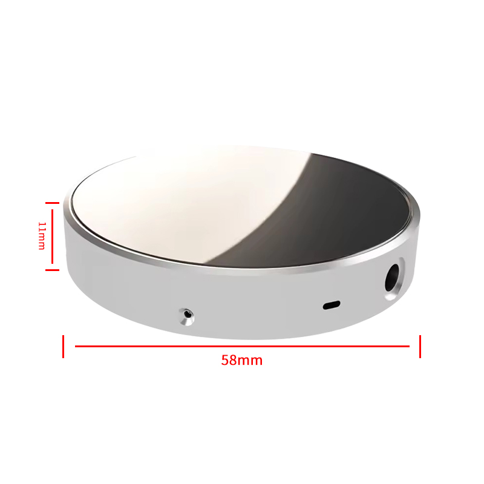

# DeskDial

A round desk display for your PC developed with Claude AI (Opus 5.5). DeskDial shows what Windows is playing, with the
artwork and play/pause, next and previous controls. Swipe up for a second page with
your PC's loads, temperatures, clocks, power and memory. It runs on the JC3636W518
board (ESP32-S3 with a 360×360 round touch screen), and a small Windows companion
feeds it over the USB-C cable that already powers it. It needs no Wi-Fi, no cloud and
no Home Assistant.

```
Spotify, browsers, VLC… ─► Windows media controls ─┐
                                                   ├─► DeskDial.exe ══USB══► board ◄── play/pause, next, prev
CPU / GPU / RAM / SSD sensors ─────────────────────┘ 
```

<p>


</p>

Both halves are modular. Build the media page, the hardware page, or both. A board and
a companion built with different modules agree on what they have in common.

| Build | Board shows | Companion needs |
|---|---|---|
| **full** (default) | media page, swipe up for hardware | administrator rights for temperatures and power |
| **media** | media page only | normal rights |
| **hardware** | hardware page only | administrator rights for temperatures and power |

## Device used
Bought on Aliexpress for ~30$

[1.8-Inch Round Screen QSPI 360 * 360 IPS Display ESP32-S3 8M PSRAM 16M FLASH Secondary Screen AIDA64 Pickup Spectrum Electronic](https://aliexpress.com/item/1005007606734344.html)

<p>

</p>

| Name | Description |
|---|---|
| Display color | RGB 262K color |
| SKU | JC3636W518C_I_Y |
| Size | 1.8 inch |
| Type | TFT |
| Driver chip | ST77916 CST816（touch） |
| Resolution | 360 * 360(Pixel) |
| Effective display area | 45.68 * 45.68(mm) |
| View | IPS |
| Operating temperature | -20℃~70℃ |
| Storage temperature | -30℃~80℃ |
| Operating Voltage | 5V |
| Power consumption | About 180mA |
| Product weight | About 50g |

## Repository layout

| Path | What it is |
|---|---|
| `firmware/` | Board firmware (PlatformIO, Arduino, LVGL 8.4) |
| `firmware/src/` | `main.cpp` (pages, loop), `link.cpp` (serial protocol), `display.cpp` (screen, brightness, PC-off mode), `media_page.cpp`, `hardware_page.cpp` |
| `firmware/src/board/jc3636w518/` | Board support: the vendor's display driver, unmodified, plus our pin map |
| `firmware/src/fonts/` | Montserrat with Latin-1, 34 px digits, and play/pause/music icons |
| `firmware/include/` | `config.h` (features and timings), `protocol.h`, `lv_conf.h` |
| `firmware/test/sim/` | Simulator: runs the firmware on Linux against fake hardware and checks it |
| `host/` | Windows companion (C#, .NET 8): `Core/`, `Media/`, `Hardware/` |
| `tools/` | `install-autostart.ps1` (start at logon), `usb-check.ps1` (which USB port your board has) |
| `docs/` | [Serial protocol](docs/protocol.md), screenshots |

## 1. Firmware

Install [PlatformIO](https://platformio.org) (the VS Code extension or the `pio` command
line), plug the board in, and from the `firmware` folder run:

```
pio run -e full -t upload        # or: -e media, -e hardware
```

PlatformIO downloads the toolchain and the exact versions the board driver needs: Arduino
core 3.3.5 through the [pioarduino](https://github.com/pioarduino/platform-espressif32)
platform (PlatformIO's own `espressif32` platform stops at core 2.x, which the panel
library doesn't support), LVGL 8.4.0, ESP32_Display_Panel 0.1.4 and ESP32_IO_Expander
0.0.2. The 1.x versions of the panel library renamed their API, so don't update them.
The build targets an ESP32-S3 with octal PSRAM. The firmware stops with a serial message
if PSRAM is missing.

**Close DeskDial.exe before uploading.** It holds the COM port, and so does a serial
monitor.

**Board variants.** The JC3636W518 uses the ESP32-S3's native USB port, so
`usb-check.ps1` reports *Native ESP32-S3 USB*. If yours reports a USB-to-serial chip
(CH340, CP210x…), build with `-DARDUINO_USB_CDC_ON_BOOT=0` in `platformio.ini`. The
"PC is off" detection needs the native port, but everything else works either way.

**Other build systems.** The features can also be switched off in
`firmware/include/config.h` (`DESKDIAL_MEDIA`, `DESKDIAL_HARDWARE`). `lv_conf.h` must be
found by LVGL (`LV_CONF_INCLUDE_SIMPLE`).

## 2. Windows companion

Install the [.NET 8 SDK](https://dotnet.microsoft.com/download/dotnet/8.0), then:

```
cd host
dotnet publish -c Release                            # media + hardware
dotnet publish -c Release -p:EnableHardware=false    # media only
dotnet publish -c Release -p:EnableMedia=false       # hardware only
```

The program is `host\bin\Release\net8.0-windows10.0.19041.0\win-x64\publish\DeskDial.exe`.
On a PC without the SDK, install the **.NET 8 Desktop Runtime**. The media module uses WPF
to draw non-Latin titles.

It finds the board by trying each COM port for the DeskDial handshake. Options:

| Option | |
|---|---|
| `--port COM5` | Use this port instead of probing |
| `--debug` | Open a console with a log: port probing, track changes, commands, sensor picks, and a `memory:` line every 30 s |
| `--spotify-only` | Show Spotify and no other app (media) |
| `--trace-time` | `--debug`, plus a CSV of the playback position as published and as sent, on your Desktop (media) |
| `--list-sensors` | Print every sensor with its identifier and the automatic picks (hardware) |

Only one copy runs at a time. Stop the autostart copy first, e.g. with
`Stop-ScheduledTask DeskDial` in an admin PowerShell.

**Which app it shows:** whatever is actually playing, whether that's Spotify, a browser
tab (YouTube in Chrome, Edge or Firefox) or VLC. If several play at once, it follows
Windows' own media flyout. When nothing is playing, it keeps showing the last paused
item, so an idle Spotify in the background doesn't take over.

### Hardware sensors

Sensors are read with [LibreHardwareMonitorLib](https://github.com/LibreHardwareMonitor/LibreHardwareMonitor)
and picked automatically, so it works on any PC. Whatever a machine doesn't expose shows as `--`.

- **Administrator rights are required** for temperatures and power. Load, clocks and
  memory work without them.
- **CPU and motherboard sensors also need the PawnIO driver.** Install it once from
  [pawnio.eu](https://pawnio.eu). It replaces the old WinRing0 driver, which Windows
  Defender blocks.
- **Default picks:**
  - CPU temperature from *CCD1 (Tdie)*, falling back to *CPU Package* or *Core (Tctl/Tdie)*.
  - CPU clock from *Cores (Average)*.
  - The GPU with the most dedicated memory. This skips the integrated graphics of Ryzen
    and Intel CPUs, which LibreHardwareMonitor lists like any other GPU.
  - GPU load, clock and temperature from *GPU Core*, power from *GPU Package*, memory from
    *GPU Memory Used / Total*.
  - The bottom row shows **RAM**, the hottest `DIMM #n` reading, and the **SSD**.
- If a pick is wrong, put a `sensors.ini` next to the exe:
  ```
  # metric = sensor identifier from --list-sensors
  gpu_temp    = /gpu-nvidia/0/temperature/2
  # which GPU to show: part of its name, or its identifier
  gpu         = RTX 4080
  # bottom row (replaces the automatic RAM/SSD picks): up to 3 sensors with labels
  temp1       = /memory/dimm/1/temperature/0
  temp1_label = RAM #1
  temp2       = /nvme/0/temperature/0
  temp2_label = SSD
  ```
  Keys: `cpu_temp cpu_load cpu_clock cpu_power gpu_temp gpu_load gpu_clock gpu_power
  vram_used vram_total`, plus `gpu`, `temp1`–`temp3` and `temp1_label`–`temp3_label`
  (labels up to 11 characters).

### Start at logon

The hardware module needs administrator rights, so DeskDial starts from Task Scheduler
instead of the Startup folder. After building, run this from an **elevated** PowerShell
in the repository folder:

```
powershell -ExecutionPolicy Bypass -File .\tools\install-autostart.ps1 -Port COM3
```

This copies the program to `%LOCALAPPDATA%\Programs\DeskDial`, registers a logon task
with the highest privileges (no UAC prompt), and starts it. Add `-NoElevation` for a
media-only build, which doesn't need administrator rights. Run the script again after
each rebuild, and use `-Remove` to uninstall. Put `sensors.ini` in the installed folder.

## Using it

- **Tap the artwork** to play or pause. The screen responds at once and shows the state
  it's moving to for 700 ms. The PC confirms the real state about 150 ms later.
- **Previous / next** buttons sit at the left and right edges.
- **Brightness:** hold the artwork (or anywhere on the hardware page) for 5 s. The slider
  goes from 10 % to 100 % in steps of 10 and previews live. *Save* keeps it across
  restarts; *Cancel* restores the previous level.
- **Idle:** when nothing plays, the PC companion isn't running, or a track has been
  paused for 2 minutes, the media page shows "Nothing is playing" and dims to 10 % after
  10 s. Any touch, or a track starting, brings it back.
- **Pages:** swipe up for the hardware page and down to return. The board remembers the
  last page. The PC only reads sensors while the hardware page is showing, and that page
  never dims.
- **Hardware page:** GPU memory and RAM across the top, CPU and GPU load arcs with the
  temperature inside and clock and power below, and labelled temperatures along the
  bottom. Values are coloured from cool blue through violet to red-pink. The ranges are
  the `SCALE_*` constants in `hardware_page.cpp`. Values switch to `--` if no data
  arrives for 3 s.
- **PC off or asleep:** an awake PC sends a USB heartbeat every millisecond, even with no
  program running. When it stops for 2 s, the board goes dark. It stops drawing, slows
  its CPU to 80 MHz and checks the touch panel every 100 ms. A touch shows "PC is off"
  for 5 s. When the heartbeat returns, the board wakes on its own and the companion
  reconnects. If the CPU clock change ever causes trouble, set `PC_OFF_CPU_MHZ` to 0 in
  `config.h`.
- **Playback speed:** the elapsed time counts at the speed the player reports (e.g. 1.5×
  on YouTube) and re-syncs whenever the speed, play/pause or the position changes.
- **Titles in any language:** Latin text is drawn by the board in Montserrat. When a
  title or artist contains characters the board has no font for (Chinese, Japanese,
  Korean, Arabic, Hebrew, Thai, Cyrillic, emoji…), the PC renders that line with
  Windows' fonts and sends it as a small image. Right-to-left text and Arabic letter
  joining come out correctly, and long titles still scroll.

  

## Simulator tests

`firmware/test/sim` compiles the real firmware sources for Linux, with fake hardware in
place of the panel, touch, USB and flash. The test plays the PC's side of the protocol
and checks how the board responds: taps, commands, dimming, the brightness dialog, PC
off, swipes, feature negotiation, text images and playback speed. It runs once for each
build (full, media, hardware).

```
make -C firmware/test/sim          # needs gcc, make and git (LVGL is cloned on first use)
make -C firmware/test/sim render   # also writes PNG screenshots to build/screens/
```

The GitHub Actions workflow runs these tests and builds every firmware and companion
variant on each push.

## Protocol

Frames in both directions are `A5 5A | type | length u32 | payload | checksum`. A
handshake exchanges the features each side was built with. See
[docs/protocol.md](docs/protocol.md).

## Licence

MIT, see [LICENSE](LICENSE). The board vendor's display driver and the fonts keep their
own licences; see [THIRD-PARTY-NOTICES.md](THIRD-PARTY-NOTICES.md).
