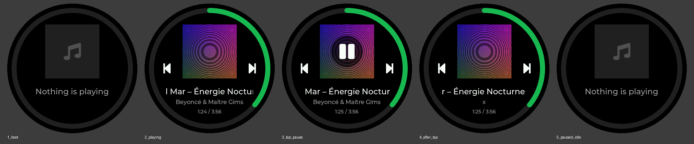
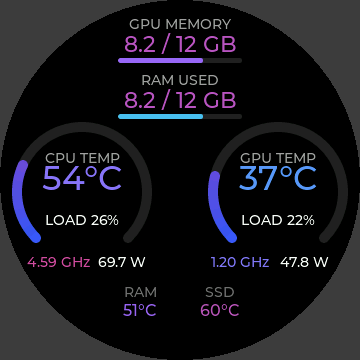

# ESP32 Media Remote

Shows what Spotify is playing on the JC3636W518 round display (ESP32-S3) and lets you
play/pause, skip and go back from the screen. Swipe up for a second page with the PC's
loads, temperatures, clocks, power and memory. The board talks to a small Windows program
over the USB-C cable that already powers it. No Home Assistant, Wi-Fi or cloud needed.

```
Spotify ─► Windows media controls ─► NowPlayingBridge.exe ══USB serial══► ESP32-S3
                                    ◄──── play/pause, next, prev ─────────
```





## Folder layout

| Path | What it is |
|---|---|
| `firmware/NowPlaying/` | Arduino sketch. Open `NowPlaying.ino`. |
| `firmware/NowPlaying/font_*.c` | Montserrat 14/16/22 with Latin-1, 34 px digits for temperatures, and a 48 px play/pause/music icon font |
| `firmware/NowPlaying/scr_st77916.h`, `pincfg.h` | Vendor driver files (unchanged copies) |
| `pc/NowPlayingBridge/` | Windows bridge (C#, .NET 8). `Hardware.cs` reads the sensors. |
| `tools/install-autostart.ps1` | Starts the bridge at logon with administrator rights |
| `tools/usb-check.ps1` | Tells you which USB connection your board uses |
| `extras/lv_conf.h` | LVGL config, for reference |

## 1. Firmware (Arduino IDE)

**Libraries** (exact versions matter):
- `ESP32_Display_Panel` **0.1.4** and `ESP32_IO_Expander` **0.0.2**
- `lvgl` **8.4.0**
- Copy `extras/lv_conf.h` into your Arduino `libraries` folder, next to the `lvgl` folder.

**Board settings** (Tools menu):
- Board: *ESP32S3 Dev Module*
- Flash size: 16 MB. Partition scheme: any with an app partition of at least 3 MB.
- PSRAM: **OPI PSRAM**. The sketch stops with a serial message if PSRAM is missing.
- USB CDC On Boot: see the next section.

**Which USB port does the board have?** Plug it in and open *Device Manager → Ports (COM & LPT)*:
- *USB Serial Device (COMx)* or *USB JTAG/serial debug unit*: the native ESP32-S3 USB. Set **USB CDC On Boot: Enabled**.
- *USB-SERIAL CH340*, *CP210x* or similar: a USB-to-UART chip. Set **USB CDC On Boot: Disabled**.

The sketch uses `Serial` and works either way. Only that menu setting has to match the hardware.

If the compiler asks for `ESP_Panel_Conf.h` or a board header, copy it from the vendor's demo
sketch into `firmware/NowPlaying/`.

**Before uploading, quit NowPlayingBridge** (end it in Task Manager, or close its console if you started
it with `--debug`). It holds the COM port, and the Arduino Serial Monitor does the same.

## 2. Windows bridge

Install the [.NET 8 SDK](https://dotnet.microsoft.com/download/dotnet/8.0), then:

```
cd pc\NowPlayingBridge
dotnet publish -c Release
```

The program is at `pc\NowPlayingBridge\bin\Release\net8.0-windows10.0.19041.0\win-x64\publish\NowPlayingBridge.exe`.

- First run: `NowPlayingBridge.exe --debug` shows port probing, track changes, commands and which
  sensors were picked. Run it from an **administrator** terminal to see temperatures.
- It finds the board by probing every COM port for its handshake. Use `--port COM5` to skip probing.
- **Which app it shows:** whatever is actually playing, whether that's Spotify, a browser tab (YouTube in Chrome,
  Edge or Firefox) or VLC. If several play at once, it follows Windows' own media flyout. When nothing is
  playing, it keeps showing the last paused item, so an idle Spotify in the background doesn't take over.
  Use `--spotify-only` to show Spotify and nothing else.

### Hardware sensors

Sensors are read with [LibreHardwareMonitorLib](https://github.com/LibreHardwareMonitor/LibreHardwareMonitor)
and picked automatically, so it works on any PC. Whatever a machine doesn't expose shows as `--`.
- **Administrator rights are required** for temperatures and power. Load, clocks and memory work
  without them.
- **CPU and motherboard sensors also need the PawnIO driver.** Install it once from
  [pawnio.eu](https://pawnio.eu). It replaces the old WinRing0 driver, which Windows Defender blocks.
- `NowPlayingBridge.exe --list-sensors` (as administrator) prints every sensor with its identifier, plus the
  automatic picks.
- **What's picked by default:**
  - CPU temperature from *CCD1 (Tdie)*, falling back to *CPU Package* or *Core (Tctl/Tdie)* on CPUs
    without it.
  - CPU clock from *Cores (Average)*.
  - The GPU with the most dedicated memory. This skips the integrated graphics in Ryzen and Intel CPUs,
    which LibreHardwareMonitor lists like any other GPU.
  - GPU load, clock and temperature from *GPU Core*, power from *GPU Package*, and memory from
    *GPU Memory Used / Total* (GB).
  - The bottom row shows **RAM**, the hottest module's `DIMM #n` reading whatever the slot layout, plus the
    **SSD**.
- If a pick is wrong, put a `sensors.ini` next to the exe:
  ```
  # metric = sensor identifier from --list-sensors
  gpu_temp    = /gpu-nvidia/0/temperature/2
  # which GPU to show: part of its name, or its identifier
  gpu         = RTX 4080
  # bottom row (replaces the automatic RAM/SSD picks): up to 3 sensors with labels
  temp1       = /memory/dimm/1/temperature/0
  temp1_label = RAM #1
  temp2       = /nvme/0/temperature/0
  temp2_label = SSD
  ```
  Keys: `cpu_temp cpu_load cpu_clock cpu_power gpu_temp gpu_load gpu_clock gpu_power vram_used vram_total`,
  plus `gpu`, `temp1`–`temp3` and `temp1_label`–`temp3_label` (labels up to 11 characters).

### Start at login

The bridge needs administrator rights, so it starts from Task Scheduler instead of the Startup folder.
After building, run this from an **elevated** PowerShell in the project folder:
```
powershell -ExecutionPolicy Bypass -File .\tools\install-autostart.ps1 -Port COM3
```
This copies the program to `%LOCALAPPDATA%\Programs\NowPlayingBridge`, registers a logon task with
the highest privileges (no UAC prompt), and starts it. Run it again after each rebuild. Use `-Remove`
to uninstall. Put `sensors.ini` in that installed folder.

## Behaviour

- **Tap the artwork** to toggle play/pause. The UI flips immediately, and a play or pause glyph shows
  for 700 ms the state it's moving *to*. The PC confirms the real state about 150 ms later.
  Stale frames are ignored for 1.5 s after a tap so the UI doesn't flicker back.
- **Prev / next** buttons sit at the left and right edges.
- **Brightness:** hold the artwork for 5 s to open the *Brightness* dialog. The slider goes from 10 % to
  100 % in steps of 10 and previews live. *Cancel* restores the previous level. *Save* stores it in the
  board's flash (NVS), and it's applied at every boot (100 % until something is saved). Idle dimming
  still drops to 10 %, and the screen returns to the saved level on wake.
- **Idle:** shown when Spotify isn't running, when the PC program isn't connected (5 s timeout),
  or when the track has been **paused for 120 s**. The display shows "Nothing is playing" and hides
  the buttons. The artwork stops responding to taps. After 10 s the backlight dims to 10 %, and it
  comes back to the saved brightness on any touch or when a track starts.
- **PC off or asleep:** an awake PC sends a USB heartbeat every millisecond, even with no program
  running. When it stops for 2 s, the board goes fully dark. It stops drawing the screen, slows the CPU to
  80 MHz, and only checks the touch panel every 100 ms. A touch lights the screen for 5 s with "PC is off".
  When the heartbeat returns, the board wakes on its own and the bridge reconnects. This needs the
  native USB port and *USB CDC On Boot: Enabled*. If the CPU clock change ever causes trouble, set
  `PC_OFF_CPU_MHZ` to 0 in the sketch.
- **Pages:** swipe **up** for the hardware page, and **down** to return to the media page. The board
  remembers the last page across restarts. The PC only reads sensors while the hardware page is showing.
- **Hardware page** (layout v2):
  - GPU and RAM memory run across the top as used / total with a bar.
  - The two arcs show CPU and GPU **load** from 0 to 100 %, with their colour shifting from blue to pink as
    they fill. Inside each arc is the temperature, with clock and power below.
  - Labelled temperatures run along the bottom: RAM (hottest module) and SSD.
  - Temperatures, clocks and memory amounts are coloured by value, from cool blue through violet to
    red-pink. The ranges are 30–90 °C for CPU/GPU, 25–75 °C for RAM/SSD, 1–5.5 GHz for CPU, 0.2–3 GHz for
    GPU, and the fill fraction for memory. They're the `SCALE_*` constants at the top of the sketch. It's never dimmed for idle, and values switch to `--`
  if no data arrives for 3 s. The "PC is off" dark mode applies to both pages. The brightness long-press
  is on the media page only.
- Track titles are filtered on the PC to the characters the fonts contain. Letters with accents outside
  Latin-1 lose the accent (ą → a). Other scripts show as `?`.

## Serial protocol

Frames in both directions: `A5 5A | type u8 | length u32 LE | payload | checksum u8`.
The full definition is in `firmware/NowPlaying/protocol.h`. Hardware readings are sent as `(metric id,
float)` pairs, so adding a metric later doesn't break older firmware. Artwork is sent pre-scaled as 150×150 RGB565
(45 KB, byte-swapped for `LV_COLOR_16_SWAP=1`), so the ESP32 never decodes a JPEG.
